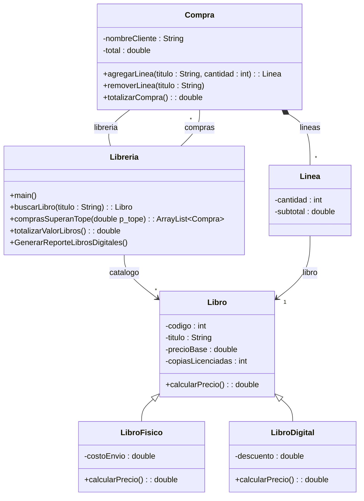

# Exámen de progrmación avanzada

Departamento de Ingeniería de sistemas
Segundo Parcial Programación Avanzada
Pontificia Universidad JAVERIANA

Bienvenidos al segundo parcial de Programación Avanzada de la facultad de ingeniería del departamento de ingeniería de sistemas de la Pontificia Universidad Javeriana. De acuerdo con el numeral 123 del reglamento de estudiantes, constituye una falta grave "*el fraude en actividades, trabajos y evaluaciones académicas...*" Por lo tanto, **todos los casos de fraude identificados serán reportados**.
Una vez iniciado el parcial, no se podrá retirar del aula hasta finalizarlo. Si se retira, el parcial será entregado una vez esté calificado.
No se pueden utilizar dispositivos electrónicos (Computadores, Celulares, Tablets u otros dispositivos).

Nombre: __________________________________________________
ID: ______________________________________________________

## I. (20 PUNTOS) CONCEPTOS

1. Sean dos objetos `obj1` y `obj2` de una clase `ClaseA`. Si se quisiera comparar los dos objetos para evaluar si son iguales, en cuanto a contenido, la instrucción que iría en el condicional sería:
* [ ] a. `obj1 == obj2`
* [ ] b. `obj1.equals(obj2)`
* [ ] c. `ClaseA.equals(obj1,obj2)`
* [ ] d. `obj1.equalsIgnoreCase(obj2)`

2. Suponga que existe una clase `Mamifero`, que hereda de la clase `Animal`. Seleccione la instrucción que es incorrecta.
* [ ] a. `Animal A = new Mamifero();`
* [ ] b. `Mamifero A = new Animal();`
* [ ] c. `Animal A = new Animal();`
* [ ] d. `Mamifero A = new Mamifero();`

3. ¿Qué palabra reservada se utiliza para impedir que una clase sea heredada por otras?
* [ ] a. `static`
* [ ] b. `abstract`
* [ ] c. `final`
* [ ] d. `protected`

4. ¿Cuál es el propósito del bloque `finally` en una estructura `try-catch`?
* [ ] a. Ejecutarse solo si ocurre una excepción.
* [ ] b. Ejecutarse solo si NO ocurre una excepción.
* [ ] c. Ejecutarse siempre, independientemente de si hubo excepción o no.
* [ ] d. Capturar excepciones de tipo `Error`.

5. ¿Qué es polimorfismo?
* [ ] a. Crear múltiples variables.
* [ ] b. Capacidad de un objeto de comportarse de diferentes maneras.
* [ ] c. Ocultar métodos.
* [ ] d. Ejecutar ciclos múltiples.

6. En Java, la clase `Object` es la única clase que no hereda de ninguna otra clase.
* [ ] a. Verdadero
* [ ] b. Falso

7. ¿Cuál de las siguientes opciones describe correctamente la sobrecarga de métodos en Java?
* [ ] a. Un método de la clase hija redefine el comportamiento de un método de la clase padre con la misma firma.
* [ ] b. Varios métodos en la misma clase comparten el mismo nombre pero difieren en el número o tipo de parámetros.
* [ ] c. Se utiliza la anotación `@Override` para indicar que el método fue sobrecargado.
* [ ] d. Solo se pueden sobrecargar métodos declarados como `static`.

8. ¿Cuál de los siguientes códigos usa un método estático?
* [ ] a. `Perro p = new Perro(); p.correr();`
* [ ] b. `System.out.println("Potencia:" + Math.pow(2,3));`
* [ ] c. `System.out.println("Metodo estatico");`
* [ ] d. `int a = 5; int b = 3; System.out.println("2+3=" + (2+3));`

9. ¿Qué imprime el siguiente código?
`String cadena = "Hola";`
`System.out.println(cadena.toUpperCase());`
* [ ] a. `hola`
* [ ] b. `HOLA`
* [ ] c. `Hola`
* [ ] d. `Error`

10. Una app de pagos tiene la clase padre `Pago` con el método `public void procesar()`. La clase hija `PagoConTarjeta` necesita redefinir ese comportamiento para incluir la validación del CVV. ¿Cuál de estas implementaciones en `PagoConTarjeta` sobre-scribe correctamente el método?
* [ ] a. `public void procesar(String cvv) { ... }`
* [ ] b. `@Override public void procesar() { /* valida CVV */ }`
* [ ] c. `public void procesarPago() { ... }`
* [ ] d. `@Override public void procesarPago(String cvv) { /* valida CVV */ }`

---

## II. (80 PUNTOS) PARTE PRÁCTICA

Una prestigiosa librería especializada lo ha contratado para crear un sistema que les permita manejar las compras que hacen sus clientes.

La librería maneja un catálogo de libros (una colección de Libros) que se almacena de forma permanente en un archivo libros.dat y que se carga en memoria al iniciar el sistema.

La clase Abstracta Libro tiene los atributos: código (entero), un título (cadena), un precioBase (double) y una cantidad existente llamada copias licenciadas (int) que corresponde con la cantidad de licencias del libro que se pueden vender.

La librería maneja también una colección de Compras. Cada Compra tiene un nombreCliente (cadena) y una colección de Líneas de compra, así como valor total de la compra (double). Cada Línea tiene el libro comprado, la cantidad de libros de la línea y el subtotal (calculado) de línea (double) que corresponde a la multiplicación de la cantidad de libros de la línea por el precio del libro. El valor total de la compra se calcula como: suma de los subtotales de líneas más el 19.

**Archivos utilizados**

* `libros.txt` (texto, enviado por proveedor)
* `libros.dat` (binario, almacenamiento permanente de libros)
* `compras.dat` (binario, almacenamiento de compras)
* `compraCliente.txt` (archivo plano generado como recibo de compra)

**Comportamiento del sistema**

* El archivo `libros.dat` se crea a partir del archivo `libros.txt`.
* Al iniciar el programa, `libros.dat` debe cargarse en memoria.
* El usuario puede realizar una compra agregando múltiples líneas.
* En la línea de compra sólo se pueden agregar libros que existan en el catálogo y tengan cantidad suficiente en copias licenciadas.
* Al agregar una línea de compra, en memoria debe descontarse el número de copias licenciadas del libro en el catálogo.
* Al finalizar la compra: se calcula el total, se genera `compraCliente.txt` y se guarda (al final) la compra en `compras.dat`.

### Diagrama de Clases UML

### Preguntas Prácticas

1. **(10 puntos)** Escriba un método en la clase Librería (buscarLibro) que busque un libro por título en el catálogo y retorne: un libro si existe o NULL si no existe. Llega como parámetro el título del libro. Suponga que el título de libro es único y NO se repite.
   - **Solución en el código:** [Libreria.buscarLibro](src/model/Libreria.java#L39)
2. **(10 puntos)** Escriba un método (totalizarCompra que retorna double) en la clase Compra que permita calcular el total de una compra: el total se calcula como la suma de los subtotales de las líneas, incrementar la suma en un 19 % que corresponde al IVA, y, guardar el resultado en el total de la compra.
   - **Solución en el código:** [Compra.totalizarCompra](src/model/Compra.java#L54)
3. **(20 puntos)** Escriba en la clase Compra un método (agregarLinea que retorna la Linea creada) que permita agregar una nueva Línea a la Compra. El método recibe el título del libro y la cantidad de libros a comprar en esa línea. Si el libro existe en el catálogo de la librería y si la cantidad disponible es suficiente (comparada con la cantidad de copias licenciadas del libro), se crea la línea y se adiciona en las líneas de la Compra; igualmente, se debe disminuir (en la cantidad comprada) el número de copias licenciadas del libro en el catálogo (en la colección de libros). También, se debe calcular y modificar el subtotal de la línea que se agrega, el subtotal se calcula como la cantidad * precio – devuelto por el método calcularPrecio()-. Finalmente se debe actualizar el atributo total de la compra sumando el subtotal de la línea agregada. Si el libro no existe o la cantidad de copias licenciadas no es suficiente se debe lanzar una excepción personalizada (asuma que la clase personalizada de excepción ya existe con un mensaje de tipo cadena).
   - **Solución en el código:** [Compra.agregarLinea](src/model/Compra.java#L72) y [CompraInvalidaException](src/model/CompraInvalidaException.java#L4)
4. **(10 puntos)** Escriba un método (comprasSuperanTope) en la clase Librería que retorne una colección de Compras cuyo total supera un tope que llega como parámetro. Para ello, el método debe agregar a la lista de retorno las compras cuyo total, calculado como la suma de los subtotales de cada línea, sea mayor al parámetro que llega al método.
   - **Solución en el código:** [Libreria.comprasSuperanTope](src/model/Libreria.java#L51)
5. **(10 puntos)** Escriba en la clase Compra un método (removerLinea que no retorna nada) que permita remover una Línea de la Compra. El método recibe el título del libro y remueve la línea cuyo libro asociado tenga el título que llega como parámetro. Se debe actualizar el número de copias licenciadas del libro removido con la cantidad especificada de libros de la línea removida. Finalmente, se debe actualizar el total de la compra.
   - **Solución en el código:** [Compra.removerLinea](src/model/Compra.java#L106)
6. **(5 puntos)** Escriba un método GenerarReporteLibrosDigitales en la clase Librería que genera un reporte en un archivo cuyo formato usted elige: librosDigitales.txt (texto) o librosDigitales.dat (binario). Usted debe generar la lista de libros a guardar y posteriormente debe enviarlos al disco duro, es decir, a un archivo en memoria secundaria.
   - **Solución en el código:** [Libreria.GenerarReporteLibrosDigitales](src/model/Libreria.java#L74)
7. **(15 puntos)** Escriba un método (totalizarValorLibros) en la clase Librería que permita calcular de forma polimórfica el valor total de los libros del catálogo, para ello en cada libro del catálogo se deben sumar: el producto del número de copias licenciadas por el precio total de cada libro (devuelto en calcularPrecio()).
   - **Solución en el código:** [Libreria.totalizarValorLibros](src/model/Libreria.java#L105)
Escriba también el método calcularPrecio() en cada una de las clases que implementan el método abstracto en Libro teniendo en cuenta las siguientes reglas:
* Para un libro digital el precio se calcula como el precio base menos el descuento. **Solución:** [LibroDigital.calcularPrecio](src/model/LibroDigital.java#L23)
* Para un libro físico el precio se calcula como el precio base más el costo del envío. **Solución:** [LibroFisico.calcularPrecio](src/model/LibroFisico.java#L23)

**Restricciones:** Para cualquiera de estos métodos puede usar métodos desarrollados en otros puntos del parcial. En caso de usar métodos adicionales o auxiliares que no estén incluidos en este enunciado, debe implementarlos completamente. Suponga también que cuenta con todos los getters y setters (puede usarlos) de todas las clases, a menos que se solicite para que sea(n) implementado(s) en alguno(s) de los puntos del parcial. No puede asumir –a menos que se le diga de foma explicita en el parcial- que existe código ya implementado.